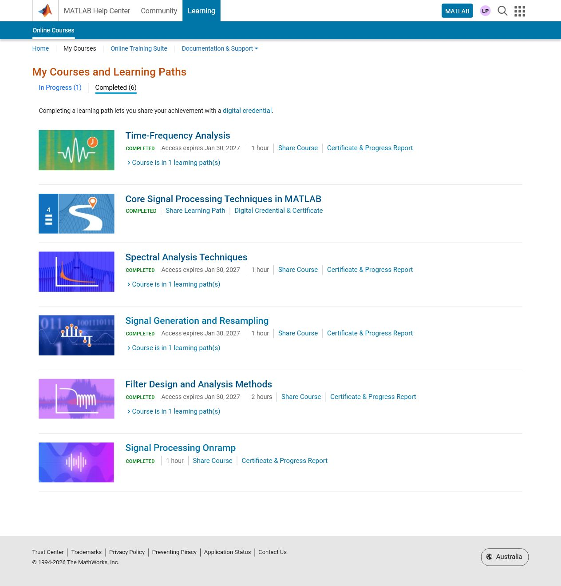

# Course certificates and completion screenshots

Verified provider completion evidence, added to this repository on 28 October 2026.
The original MathWorks pages were checked and captured on 27 October 2026.
These seven PNGs retain the original capture bytes. They are certificate-page
screenshots and a completed-course overview; no original provider PDFs are claimed.

## MathWorks

The five individual courses and the Core learning path were verified completed.

| Course or pathway | Certificate issue date | Original certificate screenshot | Provider verification |
|---|---|---|---|
| Signal Processing Onramp | 2026-10-02 | [Open screenshot](mathworks/signal_processing_onramp_certificate_full.png) | [Official certificate](https://matlabacademy.mathworks.com/progress/share/certificate.html?id=03288f19-b70d-4fb7-948f-1de28498f8aa) |
| Signal Generation and Resampling | 2026-10-02 | [Open screenshot](mathworks/signal_generation_resampling_certificate_full.png) | [Official certificate](https://matlabacademy.mathworks.com/progress/share/certificate.html?id=f24cd752-2f92-4773-8213-d26855001000) |
| Spectral Analysis Techniques | 2026-10-27 | [Open screenshot](mathworks/spectral_analysis_certificate_full.png) | [Official certificate](https://matlabacademy.mathworks.com/progress/share/certificate.html?id=3ed7866f-3a00-4cf9-9a38-5a2f9708534d) |
| Time-Frequency Analysis | 2026-10-27 | [Open screenshot](mathworks/time_frequency_analysis_certificate_full.png) | [Official certificate](https://matlabacademy.mathworks.com/progress/share/certificate.html?id=ce1baa3b-cee4-491c-890d-16676fe3d375) |
| Filter Design and Analysis Methods | 2026-10-02 | [Open screenshot](mathworks/filter_design_analysis_certificate_full.png) | [Official certificate](https://matlabacademy.mathworks.com/progress/share/certificate.html?id=d413cf1a-450b-4fa7-a193-052096eb36d7) |
| Core Signal Processing Techniques in MATLAB | 2026-10-27 | [Open screenshot](mathworks/core_learning_path_certificate_full.png) | [Official certificate](https://matlabacademy.mathworks.com/progress/share/learningpath/certificate.html?id=d4397bb7-84dc-46ab-8d57-101aec8fd462) |

[Open completed-courses overview](mathworks/completed_courses_full.png) | [Dates and file hashes](mathworks/CERTIFICATES.json)

The overview shows six completed entries: five courses plus the Core pathway.
The pathway includes four of those courses, so these are not six separate courses.

## Other resources

No additional provider certificates or whole-course completion screenshots were
found for Google MLCC, MIT 6.S191, fast.ai or TRM in the saved coursework records.
Their exercise sources and saved outputs remain available through
[the work index](../WORK_INDEX.md); a completed notebook or a module badge is not
being represented here as completion of an entire course.

## Evidence scope

These certificates establish provider-recorded MathWorks completion. They do not
change the coding catalog of 64/84 saved executions, certify local MATLAB replay,
or validate results on a physiological benchmark. The earlier account snapshots
and full offline originals remain preserved.
